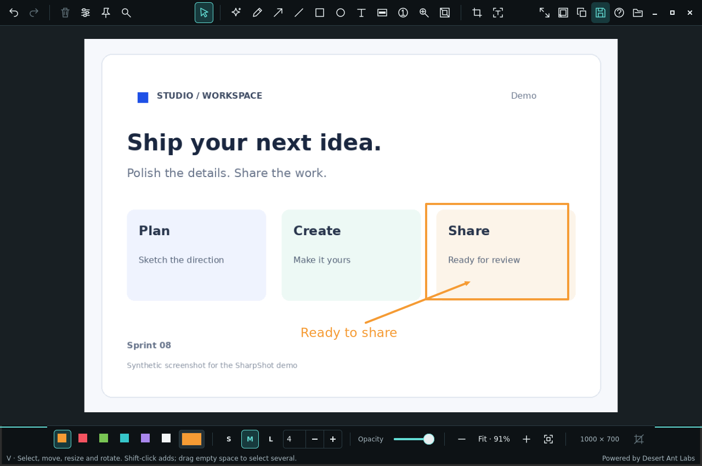
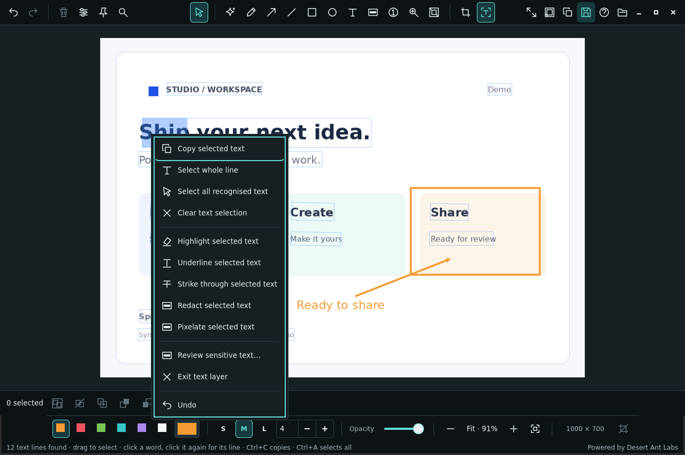

# SharpShot

A native Wayland screenshot and annotation app written in Rust. The repository is `Osyna/Screnerrr`; the application and executable are named `sharpshot`.

[](https://github.com/Osyna/Screnerrr/releases/latest)
[](https://github.com/Osyna/Screnerrr/actions/workflows/ci.yml)
[](LICENSING.md)



The demo images use synthetic content.

## Features

- Edit arrows, lines, shapes, numbered circles and captions as separate objects. Group them, change their stacking order and undo edits.
- Select recognised text with local PaddleOCR. Copy words, lines or multiline selections, then add highlights, underlines or strike-through marks.
- Cover sensitive areas with opaque redaction or a source-independent pixelated privacy zone. OCR menus can mask selected text directly.
- Crop and resize screenshots, then add backgrounds, spacing, rounded corners, borders and shadows in Designer.
- Zoom around the cursor and pan with the middle mouse button. Right-click for actions relevant to the selected object or current mode.
- Copy or export the rendered image, and save an editable `.sharp` project to continue later.



## Requirements

- Linux x86-64 with GTK 4.8+, Cairo 1.16+ and its usual desktop runtime.
- A compositor supporting the wlroots screencopy protocol for desktop capture, such as Hyprland. GNOME/KDE capture portals are not implemented.
- `slurp` for interactive region selection. Editing an existing image does not need desktop capture.
- Building additionally needs Rust 1.92 or later, Cargo, pkg-config and a C/C++ toolchain.

The release build needs glibc 2.39+ and libstdc++ providing `GLIBCXX_3.4.31` or later. The native OCR runtime rules out older environments: Debian 13 works, Debian 12 does not.

## Install

### Download a build

The [latest release](https://github.com/Osyna/Screnerrr/releases/latest) has a Linux x86-64 archive with the executable, its two native libraries and the license notices. Download it with `SHA256SUMS` into the same directory:

```sh
sha256sum -c SHA256SUMS
tar -xzf sharpshot-v0.1.0-linux-x86_64.tar.gz
cd sharpshot-v0.1.0-linux-x86_64
./sharpshot --version
```

Keep `libLiteRt.so` and `libgtk4-layer-shell.so.0` beside the executable; it finds them relative to its own path. To run it from anywhere, add that directory to `PATH` instead of copying the executable alone. The archive is not code-signed.

Runtime packages on Arch Linux:

```sh
sudo pacman -S --needed gtk4 gcc-libs slurp
```

On Debian 13:

```sh
sudo apt install libgtk-4-1 libstdc++6 slurp
```

### Build from source

Build dependencies on Arch Linux:

```sh
sudo pacman -S --needed rust base-devel pkgconf gtk4 openssl slurp
```

On Debian 13, install Rust separately using [rustup](https://rustup.rs), then:

```sh
sudo apt install build-essential pkg-config libgtk-4-dev libssl-dev ca-certificates slurp
```

Then build and check the executable:

```sh
git clone https://github.com/Osyna/Screnerrr.git
cd Screnerrr
cargo build --release --locked
./target/release/sharpshot --version
./target/release/sharpshot --help
```

The first build downloads native inference runtimes. Shapes and OCR model files are in the source tree and bundled into the executable; keep them when cloning or packaging. For installation outside the build tree and native-library redistribution, follow the [build instructions in the manual](MANUAL.md#build). Wayland reference pins additionally need GTK4 layer-shell. Binary distributions must include the relevant native libraries and [third-party notices](LICENSING.md).

## Usage

Capture a monitor and open the editor:

```sh
sharpshot
sharpshot --list-outputs      # monitor names for --output
sharpshot --output DP-1
```

Select a desktop region, or give its coordinates:

```sh
sharpshot --region
sharpshot --geometry "100,80 640x480"
sharpshot --cursor            # include the pointer
```

Edit an existing image or reopen a project:

```sh
sharpshot --input image.png
sharpshot --project screenshot.sharp
```

Capture without opening the editor, or capture a scrolling page:

```sh
sharpshot --capture capture.png
sharpshot --scroll --region
```

Pinned reference images outlive their editor. Bind this to a key to hide and show them:

```sh
sharpshot --toggle-pins
```

A Hyprland binding for the usual case:

```ini
bind = SUPER ALT, S, exec, sharpshot --region
```

### Shortcuts

`?` opens the full list inside the app.

| Keys | Action |
| --- | --- |
| `V` `S` `P` `A` `L` `R` `E` `T` | Select, smart shape, freehand, arrow, line, rectangle, ellipse, text |
| `C` `B` `N` `M` `H` | Crop, privacy zone, numbered step, magnifier, spotlight |
| `Ctrl+A`, Shift-click, marquee | Select all, add to or drag a selection |
| `Ctrl+G` / `Ctrl+Shift+G` / `Ctrl+D` | Group, ungroup, duplicate |
| `Ctrl+Home` / `Ctrl+End` | Bring to front, send to back |
| Arrows / `Shift`+arrows | Nudge 1 px or 10 px |
| Right-click, `Menu`, `Shift+F10` | Context actions for the object or mode |
| `F8` | OCR text layer |
| `Ctrl+C` / `Ctrl+S` | Copy image or recognised text, export PNG |
| `Ctrl+O` / `Ctrl+Shift+S` | Open project, save editable project |
| `Ctrl+K` / `Ctrl+I` | Command palette, object inspector |
| Wheel, middle-drag, `0`, `1` | Zoom at cursor, pan, fit, actual pixels |
| `Ctrl+Z` / `Ctrl+Shift+Z` | Undo, redo |

Commands above use the extracted archive or an installed executable. From a build tree, run `./target/release/sharpshot` instead.

See the [manual](MANUAL.md) for Designer, privacy masks, editable projects, pinned references, scrolling capture and compositor setup.

## Privacy

A flattened export and an editable project are different deliverables. An editable `.sharp` project can retain original screenshot pixels underneath redactions. Do not share it as a sanitised image. Inspect flattened exports before sharing; OCR can miss or misread text, and surrounding context can reveal information outside a mask.

Use synthetic input for bug reports. Follow [SECURITY.md](SECURITY.md) for vulnerabilities.

## Contributing

Read [CONTRIBUTING.md](CONTRIBUTING.md) and the [Code of Conduct](CODE_OF_CONDUCT.md). For development checks:

```sh
cargo fmt --check
cargo test --locked
```

Changes to capture, clipboard or the editor also need a real or isolated desktop smoke check.

## Credits

[Satty](https://github.com/Satty-org/Satty) by gabm is the direct inspiration for SharpShot, and its interface informed this one: a small single-purpose tool for wlroots compositors, a compact tool strip over the screenshot, one keystroke per tool, and annotation that stays out of the way of the image. Satty is MPL-2.0 and worth using in its own right. SharpShot is a separate implementation rather than a fork; the components it does derive from other projects are listed in [LICENSING.md](LICENSING.md), and Satty is not among them.

Satty itself credits [Swappy](https://github.com/jtheoof/swappy) and [Flameshot](https://flameshot.org/), which shaped this class of tool.

## License

Original SharpShot code is copyright (c) 2026 Osyna under the [MIT License](LICENSE), with the exceptions in [LICENSING.md](LICENSING.md).

**Powered by [Desert Ant Labs](https://desertant.com).** The bundled Shapes model and reference-derived recognition code retain the [Desert Ant Labs Source-Available License 1.0](assets/shapes/LICENSE.md), including its usage and redistribution restrictions. They are not MIT-licensed or OSI open source.

PaddleOCR, RapidOCR, ONNX Runtime and native libraries retain their own licenses. Preserve the accompanying notices when redistributing source or binaries. See [model provenance](assets/shapes/PROVENANCE.md), [OCR provenance](assets/ocr/PROVENANCE.md) and [native runtime notices](assets/runtime/NOTICE.md).
