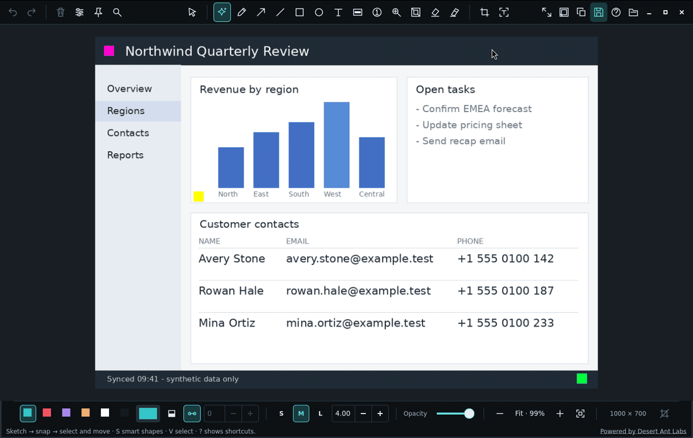

# SharpShot

A native Rust screenshot editor for Linux: capture a Wayland desktop, annotate it, select text with local OCR, and prepare a framed image to share. The repository is `Osyna/Screnerrr`; the application and executable are named `sharpshot`.

[](https://github.com/Osyna/Screnerrr/releases/latest)
[](https://github.com/Osyna/Screnerrr/actions/workflows/ci.yml)
[](LICENSING.md)



The 50-second recording uses the real GTK editor. The demo and screenshots use synthetic content.

## Features

- Sketch a smart shape, choose a correction or keep the original stroke. Manual arrows, lines, rectangles, ellipses and hold-to-size numbered markers remain editable.
- Select, group, move, resize and rotate objects. Change their stacking order, fill, rounded corners, line caps, decimal stroke widths and arrow-tip sizes. Click or hold-drag with the object eraser; one Undo restores an erase gesture.
- Type on the image with native text editing, font families and faces, bold/italic, alignment, wrapping and outline/shadow effects. Resizing keeps glyph proportions.
- Select recognised words or multiline text with on-device PaddleOCR. Preview tables, adjust row/column splits and copy TSV, CSV or Markdown. Context menus add highlighting, underlining, strike-through and direct redaction.
- Draw block and freehand highlighters. Protect sensitive areas with opaque redaction or a source-independent pixelated privacy zone; spotlight and magnifier tools call attention to details.
- Crop and resize, then use Designer looks, gradients, spacing, rounded or square corners, borders and shadows. Save frames for product screenshots and social posts.
- Zoom around the cursor, pan with the middle mouse button or touchpad, and search the command palette. Right-click menus follow the selected object or current mode.
- Copy PNGs, export privacy-safe SVG/PDF, retain private editable projects and recovery copies, pin references, or capture a scrolling page. JSON configuration adds palettes, shortcuts, stdin input and automated copy/save workflows.


## Requirements

- Linux x86-64 with GTK 4.8+, Cairo 1.16+ and GStreamer core/app/video libraries. Existing images can be edited under Wayland or X11.
- Desktop capture uses direct wlroots screencopy when available, otherwise the desktop screenshot portal on GNOME/KDE. Install the portal backend matching your desktop.
- Precision region capture has a built-in pixel loupe and keyboard adjustment. Guided scrolling still needs `slurp` unless you supply `--geometry`; portal backends may also use their own picker.
- Recording needs PipeWire, a ScreenCast portal backend, GStreamer PipeWire/base/good/bad/libav plugins and `ffmpeg` with VP9 support.
- Building needs Rust 1.92+, Cargo, pkg-config and a C/C++ toolchain.

The downloadable build needs glibc 2.39+ and libstdc++ providing `GLIBCXX_3.4.31` or later. Debian 13 works; Debian 12's native libraries are too old for this build. Fonts come from your system. Install the families you want to use, including an emoji font if needed.

## Install

### Download a build

Version 0.3.0 includes desktop portal capture, release-to-capture selection, OCR table copying, GIF/WebM recording and the object eraser. The supported release target is `x86_64-unknown-linux-gnu`; Wayland and X11 use the same archive.

Download the Linux x86-64 archive and `SHA256SUMS` from the [latest release](https://github.com/Osyna/Screnerrr/releases/latest), into the same directory:

```sh
sha256sum -c SHA256SUMS
tar -xzf sharpshot-v0.3.0-linux-x86_64.tar.gz
cd sharpshot-v0.3.0-linux-x86_64
./sharpshot --version
./sharpshot --help
```

Keep `libLiteRt.so` and `libgtk4-layer-shell.so.0` beside the executable. Add that directory to `PATH` if desired; copying the executable alone loses those libraries. The archive is not code-signed.

Runtime packages on Arch Linux:

```sh
sudo pacman -S --needed gtk4 gcc-libs slurp ttf-dejavu gstreamer gst-plugins-base gst-plugins-good gst-plugins-bad gst-libav gst-plugin-pipewire ffmpeg pipewire wireplumber xdg-desktop-portal
```

On Debian 13:

```sh
sudo apt install libgtk-4-1 libstdc++6 slurp fonts-dejavu-core libgstreamer1.0-0 libgstreamer-plugins-base1.0-0 gstreamer1.0-pipewire gstreamer1.0-plugins-base gstreamer1.0-plugins-good gstreamer1.0-plugins-bad gstreamer1.0-libav ffmpeg pipewire wireplumber xdg-desktop-portal
```

### Build from source

On Arch Linux:

```sh
sudo pacman -S --needed rust base-devel pkgconf gtk4 openssl slurp ttf-dejavu gstreamer gst-plugins-base gst-plugins-good gst-plugins-bad gst-libav gst-plugin-pipewire ffmpeg pipewire wireplumber xdg-desktop-portal
```

On Debian 13, install Rust using [rustup](https://rustup.rs), then:

```sh
sudo apt install build-essential pkg-config libgtk-4-dev libssl-dev ca-certificates slurp fonts-dejavu-core libgstreamer1.0-dev libgstreamer-plugins-base1.0-dev gstreamer1.0-pipewire gstreamer1.0-plugins-base gstreamer1.0-plugins-good gstreamer1.0-plugins-bad gstreamer1.0-libav ffmpeg pipewire wireplumber xdg-desktop-portal
```

Install your desktop's portal backend too: `xdg-desktop-portal-gnome`, `xdg-desktop-portal-kde`, or the appropriate wlroots/Hyprland backend.

Build and check the executable:

```sh
git clone https://github.com/Osyna/Screnerrr.git
cd Screnerrr
cargo build --release --locked
./target/release/sharpshot --version
./target/release/sharpshot --help
```

The first build downloads native inference runtimes. Shape and OCR models are in the source tree and embedded in the executable. For installation outside the build tree, follow the [manual's build instructions](MANUAL.md#build), including native libraries and [third-party notices](LICENSING.md). Wayland reference pins also need GTK4 layer-shell.

## Usage

Capture a monitor, a selected region or explicit desktop coordinates:

```sh
sharpshot
sharpshot --list-outputs
sharpshot --output DP-1
sharpshot --region
sharpshot --geometry "100,80 640x480"
sharpshot --cursor
```

Edit an image or reopen a private project:

```sh
sharpshot --input image.png
sharpshot --project screenshot.sharp
cat image.png | sharpshot --input -
```

File and stdin inputs accept PNG, JPEG and WebP, with compressed-byte and decoded-size limits. Stdin input opens the normal editor; it is not a headless image-conversion command.

Capture without opening the editor, or assemble a scrolling page:

```sh
sharpshot --capture capture.png
sharpshot --region --capture - > selected-region.png
sharpshot --scroll --region
```

With `--capture -`, stdout contains only PNG bytes and status goes to stderr. Pinned reference images outlive their editor; bind this to a key to hide and show them:

```sh
sharpshot --toggle-pins
```

A Hyprland launcher binding:

```ini
bind = SUPER ALT, S, exec, sharpshot --region
```

### Annotate and share

1. Draw with `S` for smart fitting, or pick a manual tool. `G` uses the primary highlighter; `Shift+G` uses the other and Ctrl at the start of a stroke swaps them. Alt draws rectangles and ellipses from their centre; Shift constrains proportions. Hold and drag to grow a numbered circle; Alt adds its extra ring.
2. Use `V` to select objects. An unfilled shape's interior is click-through. Handles resize and rotate; captions retain their proportions. `F` toggles fill, `K` toggles round line ends, and the thickness field and minus/plus controls adjust strokes independently of arrow tips or text size.
3. Click with `T` to type. Set family, size, alignment and effect in the caption strip. Enter applies, Shift+Enter inserts a line break, Escape cancels, and clicking outside the editor applies and exits typing. Formatting controls remain part of the edit. Double-click a caption to edit it again.
4. Press `F8` for the text layer. Select a word, line or multiline region, then right-click for copy and markup actions. Review recognised text before relying on it. Mask sensitive content before sharing.
5. Open Crop and resize or Designer, choose a look and adjust its frame or canvas size. Copy the result or save a PNG. Use a `.sharp` project only when you need to keep the scene editable.

`X` selects Eraser: click an annotation to remove it immediately, or hold the left button and drag across objects. It never changes the screenshot background. Ctrl+Z restores the whole stroke; Esc stops erasing and keeps removals. Privacy masks can also be erased, revealing the underlying screenshot.

### Shortcuts

`?` opens the full guide. These are defaults; custom bindings replace them, while focused text and numeric fields keep their editing keys.

| Keys | Action |
| --- | --- |
| `V` `S` `P` `A` `L` `R` `E` `T` | Select, smart shape, freehand, arrow, line, rectangle, ellipse, text |
| `X` | Eraser: click or hold-drag to remove annotations; one Undo restores the stroke |
| `C` `B` `N` `M` `H` | Crop, privacy zone, numbered step, magnifier, spotlight |
| `G` / `Shift+G` | Primary / alternate highlighter |
| `F` / `K` | Toggle fill / round line ends |
| `Alt+1` through `Alt+0` | Palette colours; open custom colour when that slot is absent |
| `Ctrl+A`, Shift-click, marquee | Select all, add to or drag a selection |
| `Ctrl+G` / `Ctrl+Shift+G` / `Ctrl+D` | Group, ungroup, duplicate |
| `Ctrl+Home` / `Ctrl+End` | Bring to front, send to back |
| Arrows / `Shift`+arrows | Nudge 1 px / 10 px |
| `Ctrl+Alt`+arrows while typing | Move the draft caption; Shift multiplies the step by 10 |
| Tap `Alt` while using Text | Cycle the caption effect |
| Right-click, `Menu`, `Shift+F10` | Context actions for the object or mode |
| `F8` | OCR text layer |
| `Ctrl+C` | Copy image, or visible recognised text while OCR is enabled; a selection limits the text |
| `Enter` outside caption editing | Run configured image actions; copy by default |
| `Ctrl+S` / `Ctrl+Alt+S` | Save PNG / always choose a PNG filename |
| `Ctrl+Alt+C` | Copy the last saved PNG path |
| `Ctrl+O` / `Ctrl+Shift+S` | Open / save an editable project |
| `Ctrl+K` / `Ctrl+I` | Command palette / object inspector |
| Wheel, middle-drag, `0`, `1` | Cursor-centred zoom, pan, Fit, actual pixels |
| Touchpad / Ctrl+touchpad / pinch | Pan / cursor-centred zoom / zoom |
| `Alt`+arrows | Pan by the configured step |
| `Ctrl+T` / `F11` / `Ctrl+Q` | Toggle toolbars / fullscreen / close screenshot |
| `Ctrl+Shift+Delete` | Clear all annotations, including masks, in one undoable edit |
| `Ctrl+Z` / `Ctrl+Shift+Z` | Undo / redo |

Commands use an extracted or installed executable. From a build tree, substitute `./target/release/sharpshot`.

### Select exact capture pixels

Run `sharpshot --region`. Drag on the frozen screenshot and release the mouse button to capture; no Enter is needed. The loupe shows source pixels at 8×. For keyboard-only selection, arrows move the region by one source pixel, Shift multiplies by ten, Ctrl+arrows adjust its right/bottom edges and Alt+arrows adjust its left/top edges; Enter captures. Escape cancels without writing the requested output.

On portal desktops, choose the source in the system dialog for normal captures. Explicit `--output`, global `--geometry` and `--cursor` remain direct-wlroots options. GNOME may remember denied screenshot permission; review desktop permissions if later requests show no dialog. Some portal backends cannot distinguish cancellation, denial and failure.

**Portal privacy:** the desktop can keep its own original screenshot in Pictures/Screenshots, including the uncropped image used by the precision selector. SharpShot does not delete portal-owned files.

### Copy a table from a screenshot

Enable OCR with F8, select the table text (or leave nothing selected to use all visible text), then choose **Copy as table** in the OCR toolbar or right-click menu. Review the inferred grid, join/split rows or columns if necessary, choose TSV, CSV or Markdown, then Copy table.

Missing cells stay empty; multiline TSV/CSV cells are quoted and Markdown line breaks become `<br>`. Spreadsheet formula-leading text is copied as a literal string. Masks and crop boundaries are respected; changing the visible table closes a stale preview before it can copy hidden text. OCR and table inference can make mistakes, so inspect the preview.

### Record a short region

```sh
sharpshot --record
```

Choose a screen/window through the system portal, select a region of at least 16 × 16 pixels (at most 8 megapixels), then start a 5–30 second recording. Controls hide by default; the timer ends recording, or use the desktop sharing indicator if it offers early stop. Uncheck Hide controls to keep a Stop button, and place it outside the recorded region.

Cursor visibility follows the portal request; the tested KWin virtual backend still embedded its cursor with Hidden requested. Check the preview before sharing.

Play the preview, adjust Start and End by frame, and save GIF or WebM. Both use 15 fps and the same kept frames; existing files are never replaced. There is no audio, timeline or composition UI. A private temporary clip is deleted when the preview closes; an abrupt process kill can leave it in the OS temporary directory.

## Configuration

Defaults are overridden by `$XDG_CONFIG_HOME/sharpshot/config.json` (normally `~/.config/sharpshot/config.json`), then by CLI options. `--config FILE` chooses an explicit file. Unknown fields and invalid values are errors. Settings use SharpShot's JSON format; Satty TOML is not imported.

See [config.example.json](config.example.json) for every saved setting. A small example:

```json
{
  "initial_tool": "smart",
  "font_family": "Sans",
  "font_style": "Regular",
  "font_fallback": ["Noto Color Emoji"],
  "default_fill": false,
  "corner_radius": 12,
  "output_filename": "~/Pictures/SharpShot-%Y-%m-%d_%H-%M-%S-%f.png",
  "on_enter": ["copy"],
  "on_escape": [],
  "keybinds": {"rectangle": "u", "toolbar": "F6"}
}
```

This changes Rectangle to `U` and toolbar visibility to `F6`; their default bindings no longer run those commands. The font fallback must be installed locally. Annotation style presets and Designer frames stay in their separate preset file.

Palettes accept `#RRGGBB` or `#RRGGBBAA`. Six-digit colours preserve object opacity; an explicit alpha channel replaces it. Key bindings use GTK accelerator syntax such as `<Ctrl><Shift>s`. `color-1` through `color-10` can bind bare digits if you prefer them to the default Fit/actual-pixel keys.

### Copy, save and exit

Actions are `copy`, `save`, `save-as`, `copy-path` and `exit`, in order. They can be assigned to Enter, Escape or right-click. Caption edits and active gestures are protected first; an unexported close still requires confirmation.

For Enter to save to a timestamped path and then close:

```sh
sharpshot --region \
  --output-filename "$HOME/Pictures/Shot-%Y-%m-%d_%H-%M-%S-%f.png" \
  --on-enter save,exit
```

Named saves create missing parent directories and refuse to overwrite an existing file. Save as always opens the chooser. `copy-path` copies the last successfully saved PNG path; output `-` streams PNG to stdout and does not become a saved file path.

For a Wayland copy-and-save workflow with independent clipboard ownership, install `wl-clipboard`, then:

```sh
sharpshot --region \
  --copy-command wl-copy \
  --output-filename "$HOME/Pictures/Shot-%Y-%m-%d_%H-%M-%S-%f.png" \
  --save-after-copy --early-exit copy
```

`--copy-command` takes repeated argv components, not an implicit shell command. For example, use `--copy-command wl-copy --copy-command=--type --copy-command image/png`. A failed copy or save leaves the editor open with an error. Native clipboard copy also refuses an automatic exit when the clipboard cannot survive closing the editor; keep it open until pasting, use a clipboard manager, or configure a helper such as `wl-copy`.

Copy helpers have a 30-second deadline. That timeout stops the direct process; multi-process wrappers must manage their children. Use `exec` for a single-command shell wrapper.

`--auto-copy` debounces document edits and does not replace the clipboard just by launching the app. `--save-after-copy` follows manual image copies, not every auto-copy.

### Window and appearance

`--width`, `--height`, `--fullscreen`, `--fullscreen-mode`, `--floating`, `--no-window-decoration`, `--hide-toolbars` and `--focus-toggle-toolbars` control launch behaviour. Floating and all-monitor fullscreen requests depend on the compositor. SharpShot keeps its tool strip when decorations are disabled.

The default view is Fit. Non-default `--zoom-factor` and `--input-scale` set initial zoom to their ratio, clamped to 10% through 400%. Mouse and touchpad navigation change the view, not exported pixels.

House chrome overrides external GTK themes. An explicit `--stylesheet FILE` is an opt-in override; invalid, non-UTF8 or oversized CSS fails at launch. `--profile-startup` prints local startup timings to stderr. Notifications are disabled by default; `--disable-notifications=false` enables them, with `--notification-thumbnail` for the rendered image.

## Privacy

A privacy zone paints opaque replacement pixels. Its mosaic does not average or sample covered source pixels. Surrounding context, mask placement and material outside the zone can still reveal information; inspect the whole flattened export before sharing. OCR can miss or misread content.

A `.sharp` project and a recovery copy retain the original screenshot, including pixels underneath redactions. Keep them private. Share rendered PNG, SVG or PDF instead. Version 0.2 writes project format 5 and reads formats 1 through 4; older executables reject the new format.

Screen capture, OCR and rendering run locally. Runtime models are embedded; no cloud OCR account is required. An external copy command is a program you choose and may have its own behaviour.

Use synthetic input for reports. See [SECURITY.md](SECURITY.md) for vulnerabilities and the [manual](MANUAL.md) for mask coverage, vector-export rules, recovery storage and compositor setup.

## Contributing

Read [CONTRIBUTING.md](CONTRIBUTING.md) and the [Code of Conduct](CODE_OF_CONDUCT.md). Development checks:

```sh
cargo fmt --check
cargo test --locked
```

Capture, clipboard and input changes also need a real or isolated desktop smoke check. The manual records the [verification scope](MANUAL.md#verification) and the limits of the headless setup.

## Credits

[Satty](https://github.com/Satty-org/Satty) is the main inspiration for SharpShot's interface and design: a screenshot-centred window, a compact icon tool strip, keyboard tool selection and annotations that stay editable. The added drawing and workflow controls follow the capabilities documented in [Satty v0.22.0](https://github.com/Satty-org/Satty/releases/tag/v0.22.0). Satty is MPL-2.0; thanks to its authors and contributors for the design and workflow inspiration.

Satty also credits [Swappy](https://github.com/jtheoof/swappy) and [Flameshot](https://flameshot.org/). Licenses for components distributed here are listed separately in [LICENSING.md](LICENSING.md).

## License

Original SharpShot code is copyright (c) 2026 Osyna under the [MIT License](LICENSE), with the exceptions in [LICENSING.md](LICENSING.md).

Powered by [Desert Ant Labs](https://desertant.com). The bundled Shapes model and reference-derived recognition code retain the [Desert Ant Labs Source-Available License 1.0](assets/shapes/LICENSE.md), including its usage and redistribution restrictions. They are not MIT-licensed or OSI open source.

PaddleOCR, RapidOCR, ONNX Runtime and native libraries retain their own licenses. Preserve the accompanying notices when redistributing source or binaries. See [shape model provenance](assets/shapes/PROVENANCE.md), [OCR provenance](assets/ocr/PROVENANCE.md) and [native runtime notices](assets/runtime/NOTICE.md).
